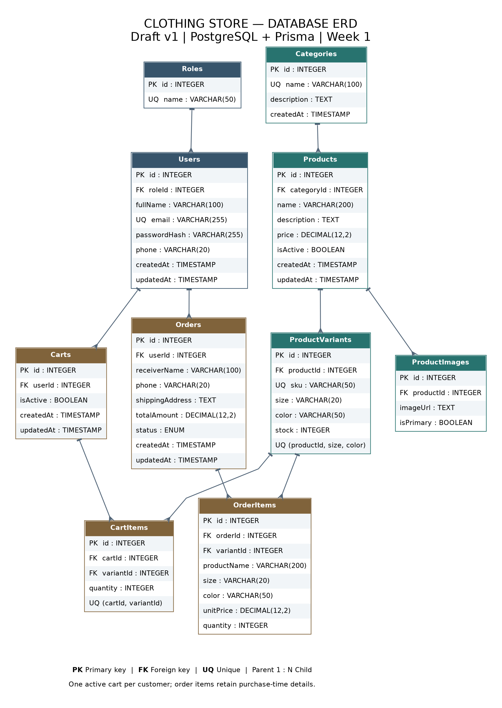

# Clothing Store - Database Design

## 1. Overview

The Clothing Store database supports user accounts, role-based access, product categories, products, product images, size/color variants, shopping carts and orders.

- Database: PostgreSQL
- ORM: Prisma
- Design status: Week 1 draft for team review

## 2. Entity Relationship Diagram

PK = Primary Key, FK = Foreign Key, UQ = Unique constraint.

## 3. Database Tables

### 3.1 Roles

Stores ADMIN, STAFF and CUSTOMER roles.

| Field | Data type | Constraints |
|---|---|---|
| id | INTEGER | PK |
| name | VARCHAR(50) | NOT NULL, UNIQUE |

### 3.2 Users

Stores user accounts and profile information.

| Field | Data type | Constraints |
|---|---|---|
| id | INTEGER | PK |
| roleId | INTEGER | NOT NULL, FK -> Roles.id |
| fullName | VARCHAR(100) | NOT NULL |
| email | VARCHAR(255) | NOT NULL, UNIQUE |
| passwordHash | VARCHAR(255) | NOT NULL |
| phone | VARCHAR(20) | Optional |
| createdAt | TIMESTAMP | NOT NULL, default current timestamp |
| updatedAt | TIMESTAMP | NOT NULL, updated on modification |

Passwords must be hashed with bcrypt before being stored. Public registration must not allow users to choose privileged roles.

### 3.3 Categories

Stores clothing categories.

| Field | Data type | Constraints |
|---|---|---|
| id | INTEGER | PK |
| name | VARCHAR(100) | NOT NULL, UNIQUE |
| description | TEXT | Optional |
| createdAt | TIMESTAMP | NOT NULL, default current timestamp |

### 3.4 Products

Stores general product information and base prices.

| Field | Data type | Constraints |
|---|---|---|
| id | INTEGER | PK |
| categoryId | INTEGER | NOT NULL, FK -> Categories.id |
| name | VARCHAR(200) | NOT NULL |
| description | TEXT | Optional |
| price | DECIMAL(12,2) | NOT NULL, greater than 0 |
| isActive | BOOLEAN | NOT NULL, default true |
| createdAt | TIMESTAMP | NOT NULL, default current timestamp |
| updatedAt | TIMESTAMP | NOT NULL, updated on modification |

### 3.5 ProductImages

Stores image URLs for each product.

| Field | Data type | Constraints |
|---|---|---|
| id | INTEGER | PK |
| productId | INTEGER | NOT NULL, FK -> Products.id |
| imageUrl | TEXT | NOT NULL |
| isPrimary | BOOLEAN | NOT NULL, default false |

A product may have multiple images, with at most one primary image.

### 3.6 ProductVariants

Stores size, color and stock for each product variant.

| Field | Data type | Constraints |
|---|---|---|
| id | INTEGER | PK |
| productId | INTEGER | NOT NULL, FK -> Products.id |
| sku | VARCHAR(50) | NOT NULL, UNIQUE |
| size | VARCHAR(20) | NOT NULL |
| color | VARCHAR(50) | NOT NULL |
| stock | INTEGER | NOT NULL, default 0, non-negative |

Unique combination: (productId, size, color).

### 3.7 Carts

Stores customer shopping carts.

| Field | Data type | Constraints |
|---|---|---|
| id | INTEGER | PK |
| userId | INTEGER | NOT NULL, FK -> Users.id |
| isActive | BOOLEAN | NOT NULL, default true |
| createdAt | TIMESTAMP | NOT NULL, default current timestamp |
| updatedAt | TIMESTAMP | NOT NULL, updated on modification |

Each customer can have at most one active cart.

### 3.8 CartItems

Stores variants and quantities in a cart.

| Field | Data type | Constraints |
|---|---|---|
| id | INTEGER | PK |
| cartId | INTEGER | NOT NULL, FK -> Carts.id |
| variantId | INTEGER | NOT NULL, FK -> ProductVariants.id |
| quantity | INTEGER | NOT NULL, greater than 0 |

Unique combination: (cartId, variantId).

### 3.9 Orders

Stores order details, delivery information and status.

| Field | Data type | Constraints |
|---|---|---|
| id | INTEGER | PK |
| userId | INTEGER | NOT NULL, FK -> Users.id |
| receiverName | VARCHAR(100) | NOT NULL |
| phone | VARCHAR(20) | NOT NULL |
| shippingAddress | TEXT | NOT NULL |
| totalAmount | DECIMAL(12,2) | NOT NULL, non-negative |
| status | ENUM | NOT NULL, default PENDING |
| createdAt | TIMESTAMP | NOT NULL, default current timestamp |
| updatedAt | TIMESTAMP | NOT NULL, updated on modification |

Proposed order statuses: PENDING, CONFIRMED, SHIPPING, COMPLETED, CANCELLED. Allowed transitions and cancellation rules require team review.

### 3.10 OrderItems

Stores purchased variants and purchase-time information.

| Field | Data type | Constraints |
|---|---|---|
| id | INTEGER | PK |
| orderId | INTEGER | NOT NULL, FK -> Orders.id |
| variantId | INTEGER | NOT NULL, FK -> ProductVariants.id |
| productName | VARCHAR(200) | NOT NULL |
| size | VARCHAR(20) | NOT NULL |
| color | VARCHAR(50) | NOT NULL |
| unitPrice | DECIMAL(12,2) | NOT NULL, greater than 0 |
| quantity | INTEGER | NOT NULL, greater than 0 |

Product name, size, color and price are saved at purchase time so later product updates do not change order history.

## 4. Relationships

All relationships below are one-to-many (one parent may have zero or many child records; each child references one parent).

| Parent | Child | Foreign key |
|---|---|---|
| Roles | Users | roleId |
| Users | Carts | userId |
| Users | Orders | userId |
| Categories | Products | categoryId |
| Products | ProductImages | productId |
| Products | ProductVariants | productId |
| Carts | CartItems | cartId |
| ProductVariants | CartItems | variantId |
| Orders | OrderItems | orderId |
| ProductVariants | OrderItems | variantId |

## 5. Proposed Constraints and Data Integrity

- All primary keys are generated integer IDs.
- Email and SKU must be unique. Email should be normalized before registration.
- Stock cannot be negative. Product prices and item quantities must be positive.
- Use PostgreSQL CHECK constraints for numeric rules and partial unique indexes for one active cart per user and one primary image per product. Confirm the implementation method when creating Prisma migrations.
- Index foreign key columns and commonly used search/filter fields where appropriate. Avoid duplicate indexes on columns already covered by unique constraints.
- Use decimal values instead of floating-point values for money.
- Keep product information separate from categories, images and variants to reduce unnecessary duplication.
- Order snapshots and stored order totals intentionally preserve historical transaction information. The backend must calculate totals from trusted prices and quantities.
- Create orders and deduct stock in a transaction with concurrency-safe stock checks to prevent overselling.

## 6. Proposed Deletion Rules

| Relationship | On delete |
|---|---|
| Roles -> Users | RESTRICT |
| Users -> Carts | RESTRICT |
| Users -> Orders | RESTRICT |
| Categories -> Products | RESTRICT |
| Products -> ProductImages | CASCADE |
| Products -> ProductVariants | RESTRICT |
| Carts -> CartItems | CASCADE |
| ProductVariants -> CartItems | RESTRICT |
| Orders -> OrderItems | RESTRICT |
| ProductVariants -> OrderItems | RESTRICT |

Use Products.isActive to remove a product from the storefront without destroying purchase history. Order history should not be hard-deleted through normal application operations. Final deletion behavior must be reviewed with Backend before implementation.

## 7. Security and Access

- ADMIN, STAFF and CUSTOMER permissions must be enforced by the backend.
- Customers can only access their own carts and orders.
- Password hashes must never be returned by the API.
- Database credentials must be stored in .env and excluded from Git.

## 8. Week 1 Review Checklist

- [x] Identify the ten candidate entities from the team guide.
- [x] Prepare the ERD and proposed fields.
- [x] Document relationships and proposed constraints.
- [ ] Review field names, types and relations with Backend.
- [ ] Confirm order status transitions, deletion behavior and payment scope.
- [ ] Approve design before creating Prisma schema and migrations.

This document covers T04 and T05 design work only. PostgreSQL setup, Prisma schema, migrations, seed data and database testing are not included in this week's implementation.
